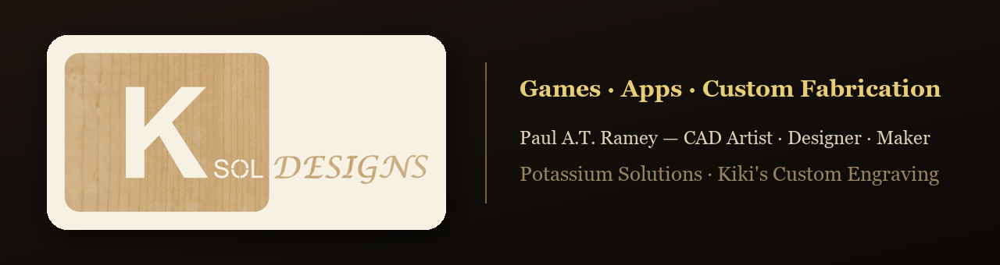
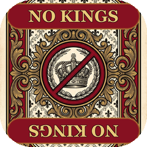
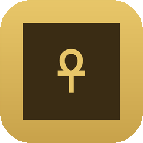
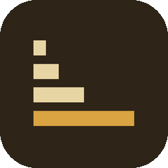
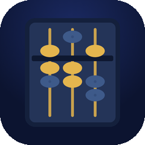
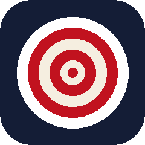
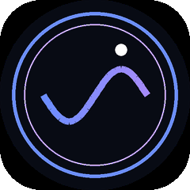
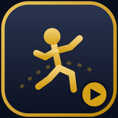

### 🎮 Play &amp; create right now — free, in your browser

<table>
<tr>
<td align="center" width="150"><a href="https://potassiumsolutions.github.io/nokings"> <b>No Kings</b></a></td>
<td align="center" width="150"><a href="https://potassiumsolutions.github.io/senet"> <b>Senet</b></a></td>
<td align="center" width="150"><a href="https://potassiumsolutions.github.io/stonecutter"> <b>Stonecutter</b></a></td>
<td align="center" width="150"><a href="https://potassiumsolutions.github.io/abacus"> <b>Abacus</b></a></td>
<td align="center" width="150"><a href="https://potassiumsolutions.github.io/dunkher"> <b>DunkHer</b></a></td>
<td align="center" width="150"><a href="https://potassiumsolutions.github.io/Sleepwave"> <b>SleepWave</b></a></td>
<td align="center" width="150"><a href="https://potassiumsolutions.github.io/glb-studio/"> <b>GLB Studio</b></a></td>
</tr>
</table>

&nbsp;

---

👋 Hi, I'm **Paul** — a CAD artist and maker behind **Ksol Designs**. I build tabletop games, teaching tools, and shop software — and cut, engrave, and 3D-print custom parts through **Kiki's Custom Engraving**.

### 🕹️ What they are

| Game | About |
|------|-------|
| 👑 **[No Kings](https://potassiumsolutions.github.io/nokings)** | A card game about toppling monarchy — also a [real printed game](https://www.thegamecrafter.com/games/no-kings-2-to-6) |
| 𓂀 **[Senet](https://potassiumsolutions.github.io/senet)** | The oldest board game on Earth, reimagined, with a 3D Egyptian artifact museum |
| 🪨 **[Stonecutter](https://potassiumsolutions.github.io/stonecutter)** | Multiply anything with the ancient doubling secret — build 3D monuments |
| 🧮 **[Abacus](https://potassiumsolutions.github.io/abacus)** | Learn the soroban by filling Silk Road trade orders and raising historic cities |
| 🎯 **[DunkHer](https://potassiumsolutions.github.io/dunkher)** | A friendlier, dunk-tank take on the word-guessing game |
| 😴 **[SleepWave](https://potassiumsolutions.github.io/Sleepwave)** | A binaural-beat sleep app with an intelligent wake system |

### 🎬 Free toolkit for game creators

- **[GLB Studio](https://potassiumsolutions.github.io/glb-studio/)** — everything a game creator needs to make the characters, boards, cards, boxes, videos and the app, in one place, in your browser. Turn a picture into a 3D model, rig it (people + 17 animal & creature types), animate it, film promo and how-to videos, build print-ready boards, maps, cards and boxes for The Game Crafter or print shops, and export a playable game → [source](https://github.com/Potassiumsolutions/glb-studio) · [how it compares](https://potassiumsolutions.github.io/glb-studio/compare.html)

  *I built it after years of learning tool after tool to make Port & Plunder and Baby Dragon. If it saves you some of that time, it's done its job.*

### 🛠️ Shop & maker tools

- **Cut Part Quote** — instant quoting for laser-cut metal & acrylic → embedded at [ksoldesigns.com](https://www.ksoldesigns.com)
- **3D Print Part Quote** — upload a part, get a price → [ksoldesigns.com](https://www.ksoldesigns.com)
- Custom laser engraving, CNC metal cutting, and 3D printing through **Kiki's Custom Engraving**

### 📱 On the app stores

- **Baby Dragon** — a physical + digital card game (Google Play)
- **Port & Plunder** — a Caribbean pirate board-game app (Google Play)

---

*Tabletop games, teaching tools, and custom fabrication — made in the workshop and on the web.*

**[www.ksoldesigns.com](https://www.ksoldesigns.com)** &nbsp;·&nbsp; ✉️ Paul@ksoldesigns.com

